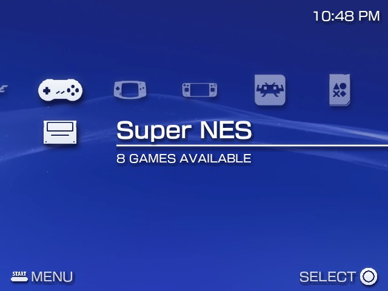
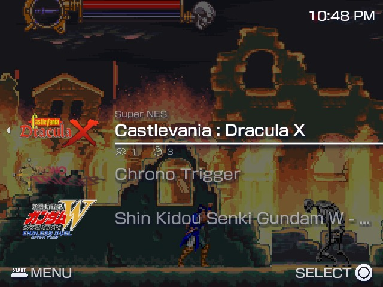
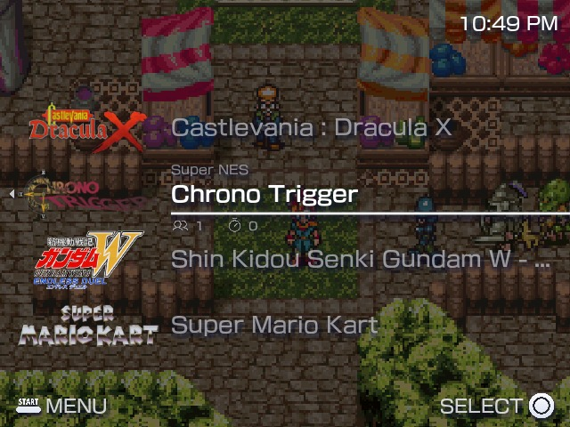
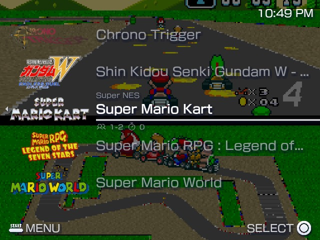

# es-theme-xmb-fcamod

**EN** · [BR](README.pt-BR.md)

 [](https://www.reddit.com/user/jovemlcxx/) [](https://ko-fi.com/jovemlcxx)

A theme inspired by the XMB (Cross Media Bar) of the PSP and PS3 for **EmulationStation-fcamod** handhelds (ArkOS family and clones), with the XMB carousel, the PSP-style game list, 20 wallpapers with animated video, four aspect ratios and **three icon styles**: PSP (soft shadows), Flat White and Flat Black.

<p align="center">
   <br>
   
</p>

[Install](#install) · [The theme](#the-theme) · [Options](#options) · [Compatibility](#compatibility) · [Customize](#customize) · [Credits](#credits-and-license)

## Install

1. Download this repository (**Code → Download ZIP**) or clone it.
2. Copy the folder to the themes folder of your device: `/roms/themes/` (the `themes` folder of the games partition), `~/.emulationstation/themes/`, or `/userdata/themes/` on Batocera and Knulli. It must be named `es-theme-xmb-fcamod` (or `es-theme-xmb-fcamod-main` from the ZIP). When updating, keep your own `_inc/background/bg_*` files and delete the old folder first.
3. **START → UI Settings → Theme Set → es-theme-xmb-fcamod**. The options are in **UI Settings → Theme Configuration**.

Leave the frontend's **Gamelist View Style** and **Grid Size** on **automatic**: other values replace the theme's game list layout.

## The theme

- **System view:** XMB carousel with the selected system's name, game count and physical media icon (cartridge, disc, tape...), or a **vertical** layout with the carousel on the left. A background video keeps playing while you browse systems.
- **Game list:** PSP style, 5 games per screen, the selected one on the same line as the system view, each with its marquee / wheel logo centered. Players and play count under the name, and the card icon for games without media.
- **Icon styles:** **PSP** (white with a soft shadow, the XMB look), **Flat White** and **Flat Black**. The style changes the system and menu icons, the game list icons, the horizontal line, the text colour and the footer buttons.
- **Footer:** Start (menu) and confirm buttons in Nintendo / Xbox or PlayStation (○ ✕) style, which you can also hide, and the frontend clock at the top.
- **Aspect ratios:** 4:3 (R36S, RG351MP, 640×480), 1:1 (RGB30, R36 Ultra, R36 Pro Max, 720×720), 16:9 and 21:9.
- **XMB sounds and fonts:** the full XMB sound set and the *FOT-NewRodin Pro* fonts.
- **Translated:** every setting follows the frontend language (26 languages).

## Options

| Option | Choices (default first) | Notes |
|---|---|---|
| **Aspect Ratio** | 4:3 / 1:1 / 16:9 / 21:9 | Match your screen. |
| **Wallpaper** | 1 to 20 | Only `1` is included. |
| **Icon Style** | PSP / Flat White / Flat Black | System, menu and game list icons, horizontal line, text colour and footer buttons (PSP adds the soft shadow). Flat Black also lightens the backgrounds: a white translucent mask in the game list and no dimming in the system view. |
| **Background Video** | Enabled / Disabled | Disable it on slow devices (less than 1 GB of RAM); the wallpaper image is used instead. |
| **System Layout** | Horizontal (XMB Classic) / Vertical (Left Bar) | The game list follows it. |
| **Color Scheme** | Dark / Light | Settings menu and on-screen keyboard. |
| **Button Icons** | Nintendo / Xbox, PlayStation | PlayStation follows the button position: A = ○, B = ✕. |
| **Confirm Button (A/B)** | A / B | Use **B** if you swapped A/B in the system (**dArkOSen** ships swapped). |
| **Footer Buttons** | Enabled / Disabled | Shows or hides the button legend at the bottom. |

## Compatibility

What has actually been tested, and how:

| | Theme |
|---|---|
| dArkOS4Clone | ✅ |
| ArkOS, arkos4clone, dArkOS, dArkOSRE-R36, dArkOSen | 🧪 |
| Batocera, Knulli, EmuELEC, ArchR, muOS | not tested |

- ✅ **Validated on real hardware** (R36S): system view, game list, the three icon styles, footer, clock, battery and menu.
- 🧪 **Checked in a simulator and against each system's EmulationStation source**, not on a real device: the theme loads and renders the same on the ES of dArkOS / dArkOSRE and dArkOSen. The only difference is the carousel's unselected items, drawn translucent by the stock ES unless the "Steam Deck UI Fixes" build is installed.

Known limits of the frontend that a theme cannot change are in [Known limitations](#known-limitations).

**Help test your system:** tell me your system, its version and what looks wrong, by [opening an issue](https://github.com/jovemlcxx/es-theme-xmb-fcamod/issues) or [on Reddit](https://www.reddit.com/user/jovemlcxx/) (u/jovemlcxx).

## Customize

Files are named after the system's `<theme>` entry in `es_systems.cfg` (e.g. `snes`, `megadrive`), not the ROM folder.

| What | Where | Size |
|---|---|---|
| Icons of a system, per style | `_inc/icons/<psp-style, flat-white, flat-black>/controller/<theme>.png` (console) and `.../physical-media/<theme>.png` (media) | 256×256 with a transparent margin (the glyph is 71 % of the image) |
| Wallpapers | `_inc/background/bg_<1-20>.png` / `.mp4` | the size of your screen |
| Layout | `aspect-ratio-4-3.xml`, `-1-1`, `-16-9`, `-21-9` | written as fractions of the screen |

### 💻 Supported Systems

The theme was checked against the frontend of each distribution below. "Platforms" are the consoles and computers each one lists in its menu (NES, PlayStation, Arcade...): every one of them gets a console icon in the carousel and a physical media icon (cartridge, disc, tape...).

| Distribution | Platforms | With their own icon | With the generic icon* |
|---|---|---|---|
| [ArkOS](https://github.com/christianhaitian/arkos) | 136 | 130 | 6 |
| [arkos4clone](https://github.com/lcdyk0517/arkos4clone) | 136 | 130 | 6 |
| [darkos4clone](https://github.com/lcdyk0517/arkos4clone) | 135 | 129 | 6 |
| [dArkOS](https://github.com/christianhaitian/dArkOS) | 129 | 127 | 2 |
| [dArkOSRE-R36](https://github.com/southoz/dArkOSRE-R36) | 126 | 124 | 2 |
| [dArkOSen](https://github.com/djparentx/dArkOSen-R36S) | 127 | 125 | 2 |
| [ArchR](https://github.com/archr-linux/Arch-R) | 136 | 134 | 2 |
| [Batocera](https://batocera.org/) | 260 | 249 | 11 |
| [EmuELEC](https://github.com/EmuELEC/EmuELEC) | 168 | 160 | 8 |
| [Knulli](https://knulli.org/) | 242 | 237 | 5 |

\* Rare platforms with no icon available anywhere use a generic controller icon. Other FCAMOD-based distributions work too; platforms the theme does not know show their name instead.

<details>
<summary>Where the icons come from, and how to add one</summary>

Icons come from the base theme [xmb-menu-es-de](https://github.com/anthonycaccese/xmb-menu-es-de), from [RetroArch Assets](https://github.com/libretro/retroarch-assets), or from an icon of the same hardware or game under another name (e.g. `pce-cd` → PC Engine CD, game ports → Ports).

To add one, place `<system theme>.png` in `_inc/systems/controller/` (console) and `_inc/systems/physical-media/` (media). The file name must match the platform's `<theme>` in `es_systems.cfg` exactly, **including upper/lower case**.

Platforms currently using the generic icon:
- **ArkOS, arkos4clone, darkos4clone:** `bbk`, `gametank`, `krkr2`, `native32`, `onscripter`, `spmp8000`
- **dArkOS, dArkOSRE-R36, dArkOSen:** `gametank`, `onscripter`
- **ArchR:** `bk`, `ios`
- **Batocera:** `bk`, `camplynx`, `cgenie`, `commanderx16`, `gametank`, `laser310`, `mc10`, `pcw`, `pdp1`, `segaai`, `tvgames`
- **EmuELEC:** `bk`, `iphone`, `mc10`, `mtx512`, `p2000t`, `redshift`, `tvgc`, `x16`
- **Knulli:** `camplynx`, `commanderx16`, `laser310`, `pdp1`, `plugnplay`

</details>

### 👾 Game List Icons

Each game shows its **marquee** image. Any size or shape works (wide logos, square art like 720x720, tall images): it is scaled to fit and centered, and names always start on the line. In the scraper, pick **Marquee** or **Wheel** (logo) as the source; both are saved as the marquee. Games without one (e.g. most Ports) show the default game icon, and folders the folder icon.

### 🖼️ Wallpapers

The theme has 20 wallpaper slots. Each one is an **image** (`.png`) and, optionally, an **animated video** (`.mp4`) that plays on top of it. Only slot `1` comes with the theme; you can fill the others with your own.

#### 1. Find your screen size

Your wallpaper should have **the same proportion as your screen**. The theme stretches it to fill the whole screen, so a wallpaper with another shape ends up squashed or stretched.

| Screen | Proportion | Size to use | Examples |
|---|---|---|---|
| Standard handheld | 4:3 | **640x480** (or 1024x768) | R36S, RG351MP, RG353V |
| Square screen | 1:1 | **720x720** | RGB30, R36 Ultra, R36 Pro Max |
| Widescreen handheld | 16:9 | **854x480** or **960x544** | RGB10 Max, Odroid Go Super, RG503 |
| TV / monitor | 16:9 | **1920x1080** (or 1280x720) | Batocera on a TV or PC |
| Ultrawide monitor | 21:9 | **2560x1080** | Batocera on PC |

> 💡 Not sure? Use the size of your device's screen resolution. Using a bigger size than the screen only makes the file heavier.

#### 2. Crop your image

Any free tool works. The idea is always the same: create a canvas with the size above, place your image on it and enlarge it until it covers the whole canvas. The parts that go outside are cut off.

**With [Canva](https://www.canva.com/) (browser or phone, free):**
1. **Create a design** > **Custom size** and type the size from the table (e.g. `640` x `480` px).
2. **Uploads** > **Upload files** and pick your image, then drag it onto the page.
3. Right-click it (or long-press on the phone) > **Set image as background**. It fills the page; double-click it to move it and choose which part stays visible.
4. **Share** > **Download** > **PNG** > **Download**.

**With [Photopea](https://www.photopea.com/) (free, in the browser, Photoshop-like):**
1. **File** > **New**, type the width and height, **Create**.
2. **File** > **Open & Place** and pick your image.
3. Hold **Shift** and drag a corner until the image covers the whole canvas, then press **Enter**.
4. **File** > **Export as** > **PNG** > **Save**.

On a PC you can also use **Paint** (Windows) or **Preview** (Mac) with the crop and resize tools, as long as the final size matches the table.

#### 3. Prepare a video (optional)

Videos follow the same rule: same size as the screen, in **.mp4**.

- **Canva:** create the design with the custom size, upload the video, set it as background, then **Share** > **Download** > **MP4 Video**.
- **[ezgif.com](https://ezgif.com/video-resize) (no sign-up):** **Video resize** to change the size and **Crop video** to cut the edges; save the result as MP4. Good for short clips.
- **CapCut / Clipchamp:** free editors that also export MP4 with a custom size, if you want to trim or edit the clip.

To keep it smooth on handhelds:
- Keep it **short** (10 to 30 seconds): it loops forever, so a clip whose end matches its start looks best.
- Remove the **sound** (in Canva, mute the video before downloading): a background does not need it, and the file gets smaller.
- Prefer **30 fps** and a file **under ~20 MB**. Big or long videos can stutter or slow down the menus on devices with less than 1GB of RAM.

**Always make the matching image too**, ideally the video's **first frame**: it shows while the video loads and whenever the video is disabled; without it the screen stays black in those moments. On ezgif, **Video to JPG/PNG** splits the video into images: keep the first one. In Canva, downloading the same design as **PNG** also gives you a still image of it.

<details>
<summary>Advanced: ffmpeg commands</summary>

```
ffmpeg -i input.mp4 -vf "scale=640:480:force_original_aspect_ratio=increase,crop=640:480" -an -r 30 -c:v libx264 -crf 23 -movflags +faststart bg_2.mp4
ffmpeg -i bg_2.mp4 -frames:v 1 bg_2.png
```
The first command fills and crops the video to 640x480 (change both pairs of numbers to your size), removes the sound and converts it to 30 fps. The second saves its first frame as the PNG.

</details>

#### 4. Name the files and copy them

1. Pick a free slot number from **2 to 20** and name the files with it: `bg_2.png` and, if you have one, `bg_2.mp4`. Both must use the **same number**, all in lower case.
2. Copy them to the theme's `_inc/background/` folder (e.g. `/roms/themes/es-theme-xmb-fcamod/_inc/background/`).
3. On the device: **Theme Configuration** > **Wallpaper** > choose the number. To show only the image, set **Background Video** to **Disabled**.

> ⚠️ Keep your wallpapers when updating the theme: copy your `bg_*` files somewhere before deleting the old theme folder, and put them back afterwards.

## Known limitations

These come from the frontends and cannot be changed by a theme:

- **Sounds:** Stock FCAMOD only plays the navigation, launch and back sounds; select, favorite and quick system select are ignored.
- **Fast scrolling:** FCAMOD hides the selected game's background while you scroll fast; it returns when you stop.
- **A/B swap:** The theme cannot detect it, hence the **Confirm Button (A/B)** option. The full native button legend does not fit small screens in most languages.
- **Batocera, Knulli, ArchR and EmuELEC:** a long name that was scrolling may stay shifted and cut off after you move to another game, until the list is redrawn. FCAMOD is not affected.

## Credits and license

**License:** [CC BY-NC-SA 4.0](LICENSE), the same as my other themes. Free: selling it, alone or bundled with devices, SD cards or images, is not allowed. Third-party assets keep their own licenses (see [`LICENSE`](./LICENSE)). The PSP icon style is an original interpretation of the XMB look: no image from Sony's PSP is included.

- [anthonycaccese/xmb-menu-es-de](https://github.com/anthonycaccese/xmb-menu-es-de): base project; structure, system and PlayStation button icons and sounds, adapted for FCAMOD.
- [mohamedhany1024/ps3-xmb-web](https://github.com/mohamedhany1024/ps3-xmb-web) and [RobZombie9043/xmb-es-de](https://github.com/RobZombie9043/xmb-es-de): XMB layout references.
- [lcdyk0517/arkos4clone](https://github.com/lcdyk0517/arkos4clone): guidance for ArkOS compatibility.
- [RetroArch Assets](https://github.com/libretro/retroarch-assets): additional system and media icons. [EmulationStation-fcamod](https://github.com/christianhaitian/EmulationStation-fcamod): extra button icons.
- **TizzyT:** animated background ([original video](https://youtu.be/69RqDjCYiek)).

**Support:** if this theme is useful to you, you can support my work on [Ko-fi](https://ko-fi.com/jovemlcxx). Thank you! ☕

[](https://ko-fi.com/jovemlcxx)
