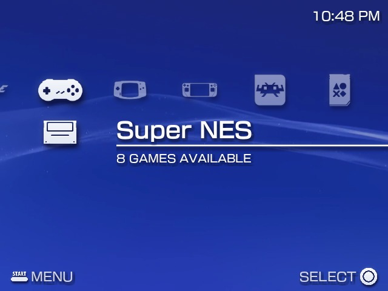
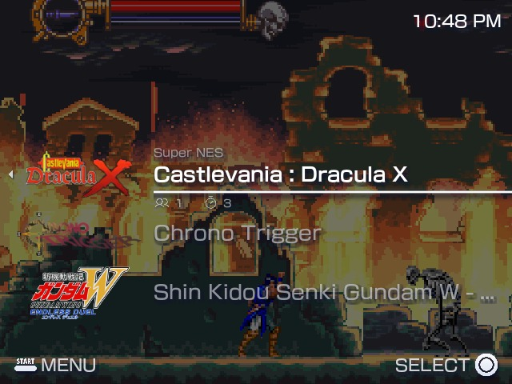
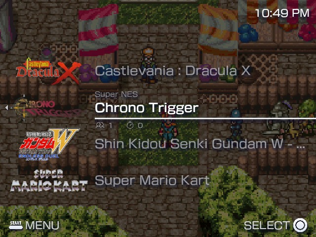
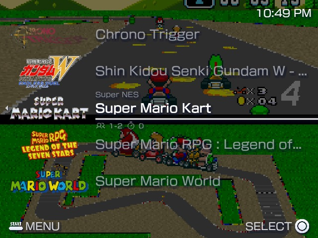

# es-theme-xmb-fcamod

[EN](README.md) · **BR**

  

Tema inspirado no XMB (Cross Media Bar) do PSP e do PS3 para handhelds com **EmulationStation-fcamod** (família ArkOS e clones), com o carrossel XMB, a lista de jogos no estilo PSP, 20 papéis de parede com vídeo animado, quatro proporções de tela e **três estilos de ícones**: PSP (sombras suaves), Flat Branco e Flat Preto.

    
   

[Instalar](#instalar) · [O tema](#o-tema) · [Opções](#opções) · [Compatibilidade](#compatibilidade) · [Personalizar](#personalizar) · [Créditos e licença](#créditos-e-licença)

## Instalar

1. Baixe este repositório (**Code → Download ZIP**) ou clone-o.
2. Copie a pasta para a pasta de temas do aparelho: `/roms/themes/` (a pasta `themes` da partição de jogos), `~/.emulationstation/themes/` ou `/userdata/themes/` no Batocera e no Knulli. Ela deve se chamar `es-theme-xmb-fcamod` (ou `es-theme-xmb-fcamod-main`, se vier do ZIP). Ao atualizar, guarde os seus arquivos `_inc/background/bg_*` e apague a pasta antiga antes.
3. **START → UI Settings → Theme Set → es-theme-xmb-fcamod**. As opções ficam em **UI Settings → Theme Configuration**.

Deixe o **Gamelist View Style** e o **Grid Size** do frontend em **automático**: outros valores substituem o layout da lista de jogos do tema.

## O tema

- **System view:** carrossel XMB com o nome do sistema selecionado, a quantidade de jogos e o ícone da mídia física (cartucho, disco, fita...), ou um layout **vertical** com o carrossel à esquerda. Um vídeo de fundo continua tocando enquanto você troca de sistema.
- **Lista de jogos:** estilo PSP, 5 jogos por tela, o selecionado na mesma linha da system view, cada um com o logo (marquee / wheel) centralizado. Jogadores e partidas sob o nome, e o ícone de card para jogos sem mídia.
- **Estilos de ícones:** **PSP** (branco com sombra suave, o visual do XMB), **Flat Branco** e **Flat Preto**. O estilo muda os ícones de sistema e de menu, os ícones da lista de jogos, a linha horizontal, a cor do texto e os botões do rodapé.
- **Rodapé:** botões Start (menu) e confirmar no estilo Nintendo / Xbox ou PlayStation (○ ✕), que também podem ser escondidos, e o relógio do frontend no topo.
- **Proporções de tela:** 4:3 (R36S, RG351MP, 640×480), 1:1 (RGB30, R36 Ultra, R36 Pro Max, 720×720), 16:9 e 21:9.
- **Sons e fontes do XMB:** o conjunto completo de sons do XMB e as fontes *FOT-NewRodin Pro*.
- **Traduzido:** todas as opções seguem o idioma do frontend (26 idiomas).

## Opções

| Opção | Escolhas (a primeira é o padrão) | Observações |
|---|---|---|
| **Aspect Ratio** | 4:3 / 1:1 / 16:9 / 21:9 | Combine com a sua tela. |
| **Wallpaper** | 1 a 20 | Só o `1` vem com o tema. |
| **Icon Style** | PSP / Flat White / Flat Black | Ícones de sistema, de menu e da lista de jogos, linha horizontal, cor do texto e botões do rodapé (o PSP acrescenta a sombra suave). O Flat Black também clareia os fundos: máscara branca translúcida na lista de jogos e sem escurecimento na system view. |
| **Background Video** | Enabled / Disabled | Desative em aparelhos lentos (menos de 1 GB de RAM); a imagem do papel de parede é usada no lugar. |
| **System Layout** | Horizontal (Clássico XMB) / Vertical (Barra Lateral) | A lista de jogos acompanha. |
| **Color Scheme** | Dark / Light | Menu de configurações e teclado na tela. |
| **Button Icons** | Nintendo / Xbox, PlayStation | O PlayStation segue a posição do botão: A = ○, B = ✕. |
| **Confirm Button (A/B)** | A / B | Use **B** se você trocou A/B no sistema (o **dArkOSen** já vem trocado). |
| **Footer Buttons** | Enabled / Disabled | Mostra ou esconde a legenda dos botões no rodapé. |

## Compatibilidade

O que foi testado de fato, e como:

| | Tema |
|---|---|
| dArkOS4Clone | ✅ |
| ArkOS, arkos4clone, dArkOS, dArkOSRE-R36, dArkOSen | 🧪 |
| Batocera, Knulli, EmuELEC, ArchR, muOS | não testado |

- ✅ **Validado em hardware real** (R36S): system view, lista de jogos, os três estilos de ícones, rodapé, relógio, bateria e menu.
- 🧪 **Conferido em simulador e no código do EmulationStation de cada sistema**, não em aparelho real: o tema carrega e renderiza igual no ES do dArkOS / dArkOSRE e do dArkOSen. A única diferença são os itens não selecionados do carrossel, desenhados translúcidos pelo ES padrão, a menos que o build "Steam Deck UI Fixes" esteja instalado.

**Ajude a testar o seu sistema:** conte qual é o seu sistema, a versão e o que está errado, [abrindo uma issue](https://github.com/jovemlcxx/es-theme-xmb-fcamod/issues) ou [no Reddit](https://www.reddit.com/user/jovemlcxx/) (u/jovemlcxx).

## Personalizar

Os arquivos têm o nome da entrada `<theme>` do sistema no `es_systems.cfg` (por exemplo `snes`, `megadrive`), e não o da pasta de ROMs.

| O quê | Onde | Tamanho |
|---|---|---|
| Ícones de um sistema, por estilo | `_inc/icons/<psp-style, flat-white, flat-black>/controller/<theme>.png` (console) e `.../physical-media/<theme>.png` (mídia) | 256×256 com margem transparente (o desenho ocupa 71 % da imagem) |
| Papéis de parede | `_inc/background/bg_<1-20>.png` / `.mp4` | o tamanho da sua tela |
| Layout | `aspect-ratio-4-3.xml`, `-1-1`, `-16-9`, `-21-9` | escrito como frações da tela |

### Papéis de parede

O tema tem 20 espaços de papel de parede. Cada um é uma **imagem** (`.png`) e, se quiser, um **vídeo animado** (`.mp4`) que toca por cima. Só o espaço `1` vem com o tema.

1. **Descubra o tamanho da sua tela:** o papel de parede deve ter a **mesma proporção da tela** (4:3 → 640×480; 1:1 → 720×720; 16:9 → 854×480 ou 1920×1080; 21:9 → 2560×1080).
2. **Recorte a imagem** em qualquer editor gratuito ([Canva](https://www.canva.com/), [Photopea](https://www.photopea.com/), Paint): crie um quadro com o tamanho acima, cubra-o com a imagem e exporte em PNG.
3. **Vídeo (opcional):** mesmo tamanho da tela, em **.mp4**, curto (10 a 30 s), sem som, 30 fps e abaixo de ~20 MB. Faça sempre também a imagem correspondente, de preferência o **primeiro quadro** do vídeo.
4. **Nomeie e copie:** escolha um número livre de **2 a 20** e use o mesmo número nos dois arquivos (`bg_2.png` e `bg_2.mp4`), tudo em minúsculas, em `_inc/background/`. No aparelho: **Theme Configuration → Wallpaper**.

> ⚠️ Guarde os seus papéis de parede ao atualizar o tema: copie os arquivos `bg_*` antes de apagar a pasta antiga.

## Limitações conhecidas

Vêm dos frontends e um tema não consegue mudar:

- **Sons:** o FCAMOD padrão só toca os sons de navegação, lançar e voltar.
- **Rolagem rápida:** o FCAMOD esconde o fundo do jogo selecionado enquanto você rola rápido.
- **Troca de A/B:** o tema não consegue detectar, daí a opção **Confirm Button (A/B)**.
- **Batocera, Knulli, ArchR e EmuELEC:** um nome longo que estava rolando pode ficar deslocado até a lista ser redesenhada.

## Créditos e licença

**Licença:** [CC BY-NC-SA 4.0](LICENSE), a mesma dos meus outros temas. Gratuito: vender o tema, sozinho ou junto com aparelhos, cartões SD ou imagens, não é permitido. Materiais de terceiros mantêm as próprias licenças (veja o [`LICENSE`](./LICENSE)). O estilo PSP dos ícones é uma interpretação original do visual do XMB: nenhuma imagem do PSP da Sony está incluída.

Baseado no [xmb-menu-es-de](https://github.com/anthonycaccese/xmb-menu-es-de) (CC BY-NC-SA), com referências de layout de [mohamedhany1024/ps3-xmb-web](https://github.com/mohamedhany1024/ps3-xmb-web) e [RobZombie9043/xmb-es-de](https://github.com/RobZombie9043/xmb-es-de), ícones do [RetroArch Assets](https://github.com/libretro/retroarch-assets), orientação de compatibilidade do [lcdyk0517/arkos4clone](https://github.com/lcdyk0517/arkos4clone) e o vídeo animado de **TizzyT** ([original](https://youtu.be/69RqDjCYiek)).

**Apoio:** se este tema é útil para você, pode apoiar o meu trabalho no [Ko-fi](https://ko-fi.com/jovemlcxx). Obrigado! ☕

